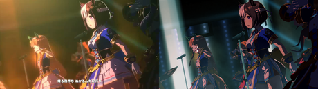
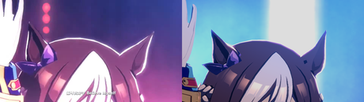
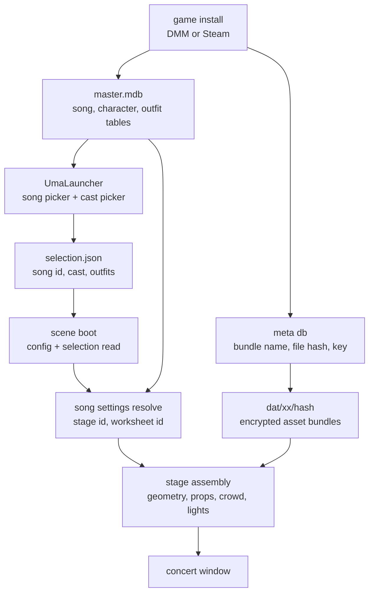
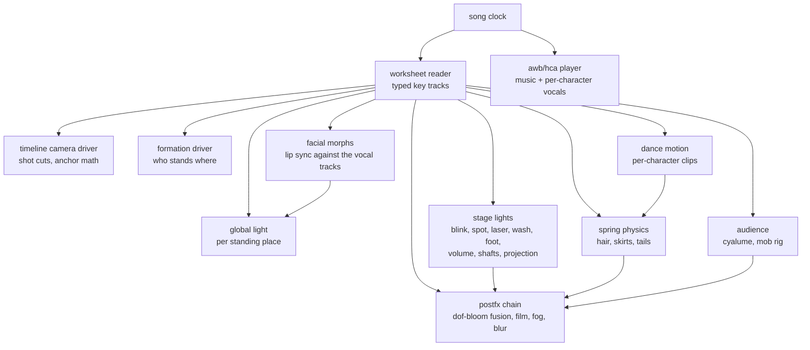
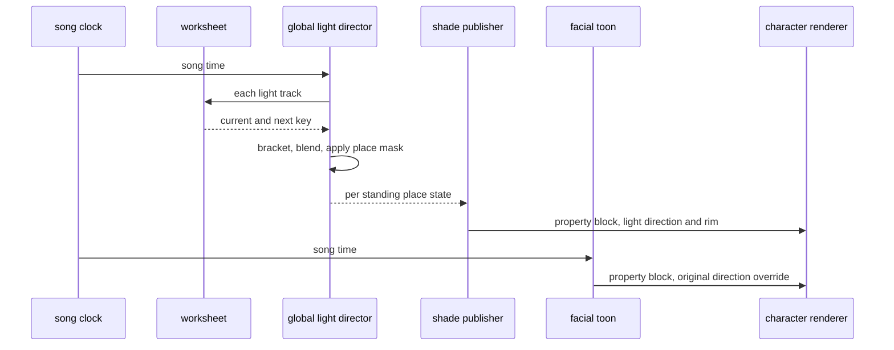

# UmaLive

<p align="center">
  
  
</p>

A live concert renderer for Umamusume: Pretty Derby. Work in progress, so
details still shift as the song data gets followed closer.

Roadmap: per-standing-place lighting finished against the official footage,
then the remaining stage layers brought in line the same way, namely the
floor reflections, the crowd, the beam geometry and the camera cuts.

*Official game footage on the left, UmaLive on the right, same song frame.*

UmaLauncher is the front end: you pick a song and its cast there, then the
launch button starts this viewer with your selection. This repository holds
the concert player. It reads the song, stage, and character data from your
own game installation at runtime, so nothing from the game ships with the
exe.

## Requirements

- Windows x64
- Umamusume: Pretty Derby installed (DMM or Steam, a full, updated install)
- UmaLauncher runs from the same folder as UmaLive.exe

## How it works

UmaLauncher reads the song, character, and outfit tables from the game
database, you pick the cast, and the launch button writes `selection.json`
(song id and the cast with outfits) next to UmaLive.exe and starts it. The
viewer reads that file, resolves the stage from the song's settings at
runtime, and opens the concert window with the stage built from the game's
own data: geometry, cast, shaders, dance motion, formation, timeline camera,
stage lighting, crowd, props and mic stands, vocals, and facial animation
with lip sync.

## Project structure

```
Assets/
  Scripts/
    app/            entry, scene boot, config, selection json io
    data/           sqlite readers (master + encrypted meta), bundle decrypt stream
    concert/        song catalog, character catalog, member rules
    cutt_stubs/     timeline data classes matching the game's serialized shapes
    ui/             concert window, ui factory
    audio/          awb/hca music and vocal playback
    live/
      camera/       timeline camera driver and character anchor math
      crowd/        audience, cyalume, mob rig
      facial/       facial morph, lip sync, per-character toon shading
      formation/    formation placement driver
      lights/       global light, blink, spot, laser, wash, foot, volume,
                    shafts, projection
      motion/       dance clip playback
      physics/      cy spring cloth (hair, skirts, tails)
      postfx/       post processing chain (dof-bloom fusion, film, fog, blur)
      props/        stage props and mic rigs
      stage/        stage assembly, shaders, vocal mixer, mirror reflection
      timeline/     worksheet reader, key types, clock, easing
  Editor/           scene baker and batch build entry
  Plugins/          sqlite natives and the cy spring solver for windows/linux
  Resources/        post processing shaders
  Shaders/          fog and radial blur shaders
images/              official-versus-render comparison frames
Tools/
  UmaLauncher/      winforms front end: song list, cast picker, updater
ProjectSettings/     unity 2022.3.62, IL2CPP standalone
```

## Architecture

Boot chain, from picking a song to the stage being live:



Inside the player, a single clock drives everything. The worksheet is the
game's own timeline format, one big schedule of typed tracks, and each
system below reads only its tracks and applies its keys at the song time
the clock hands it:



The global light is per cast member, not one lamp for the whole stage. The
song carries several light tracks; each one brackets its own key pair, and
each key names the standing places it lights. A character covered by a
later track takes that track's direction and rim values, and a character no
track covers keeps what it had. The facial toon then lands last, so its own
direction wins the shared head properties:



## Building

Unity 2022.3.62f2, IL2CPP, Windows x64. CI builds the exe on version tags and
on demand from the `experimental` branch.

## Special thanks

- [UmamusumeExplorer](https://github.com/MarshmallowAndroid/UmamusumeExplorer) -
  the UmaLauncher UI skeleton
- [UmaViewer](https://github.com/katboi01/UmaViewer) - the original idea
- [UmaViewer (katboi fork)](https://github.com/zuoy865-stack/UmaViewer) -
  newer updates to katboi's viewer, and the source of the
  `CySpringPlugin.dll` native cloth solver this renderer borrows for hair,
  skirts, and tails
- [vgmstream](https://github.com/vgmstream/vgmstream) - the hca decoder in
  `Assets/Scripts/audio/third_party/ClHcaSharp` is a port of its
  `src/coding/hca_decoder.c`, which is how the songs and vocals play
- [Il2CppDumper](https://github.com/Perfare/Il2CppDumper) - the il2cpp
  metadata dumps that made the runtime format work possible
- [AssetRipper](https://github.com/AssetRipper/AssetRipper) - bundle and
  asset inspection while figuring out the stage and character formats

## License

MIT, see LICENSE. This repository contains no game data; the viewer reads
the user's own game installation at runtime.
